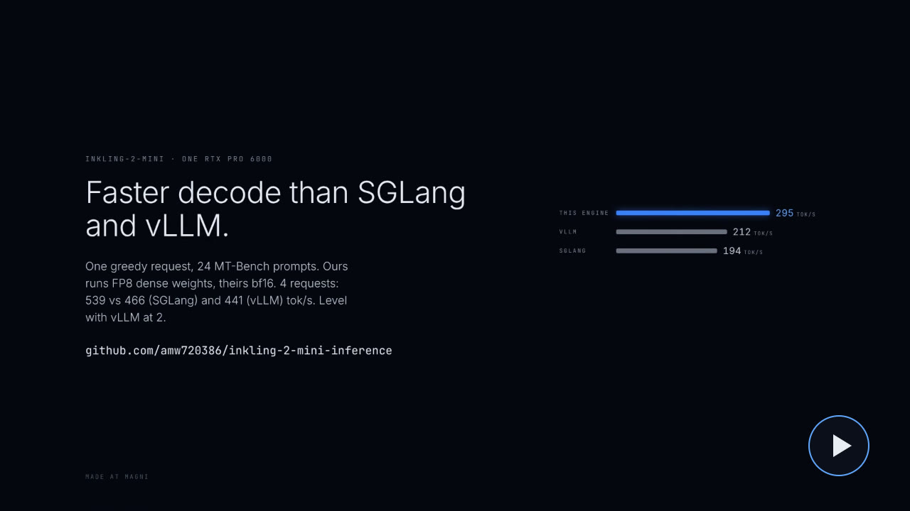
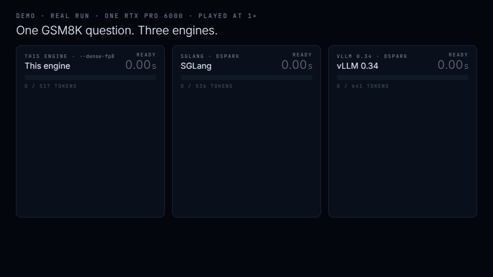
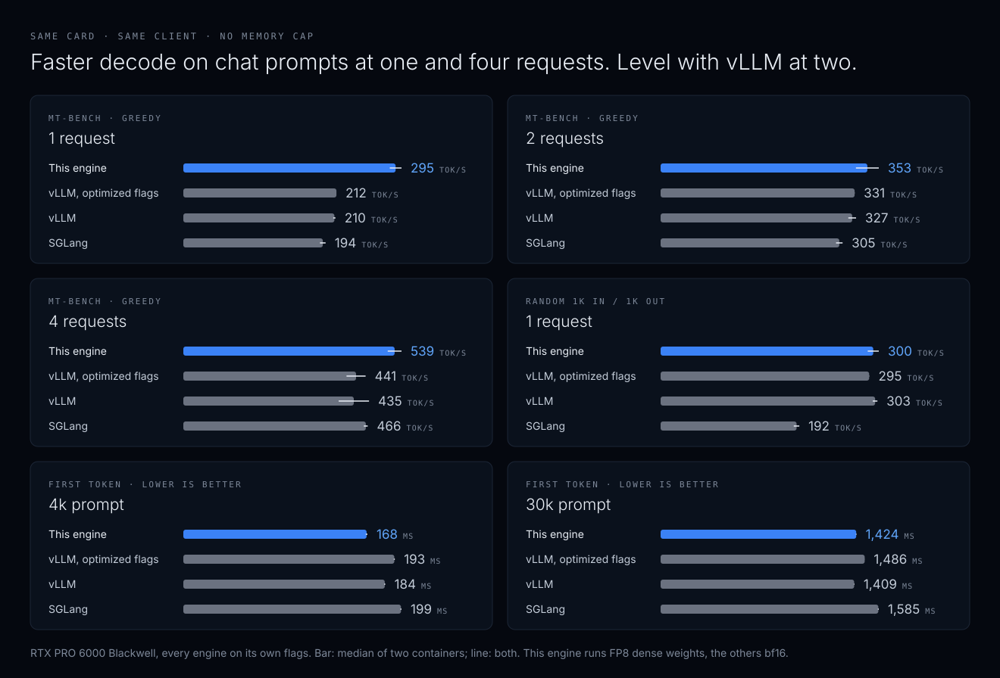
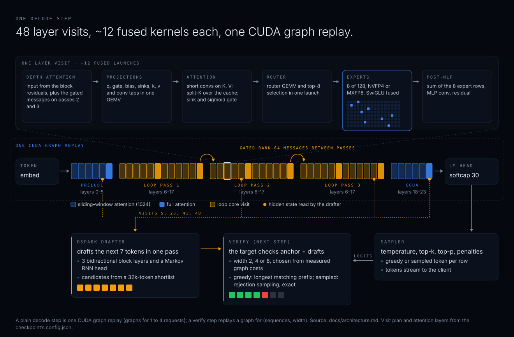
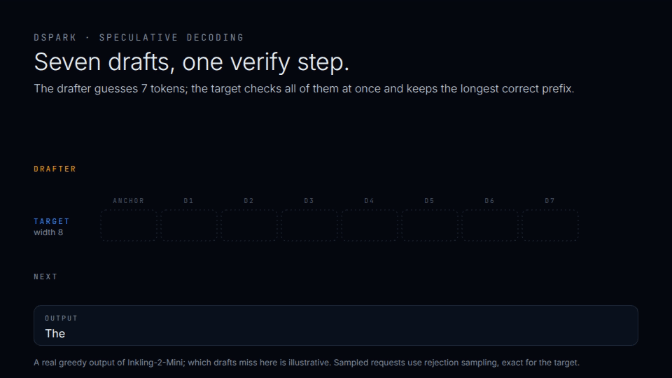
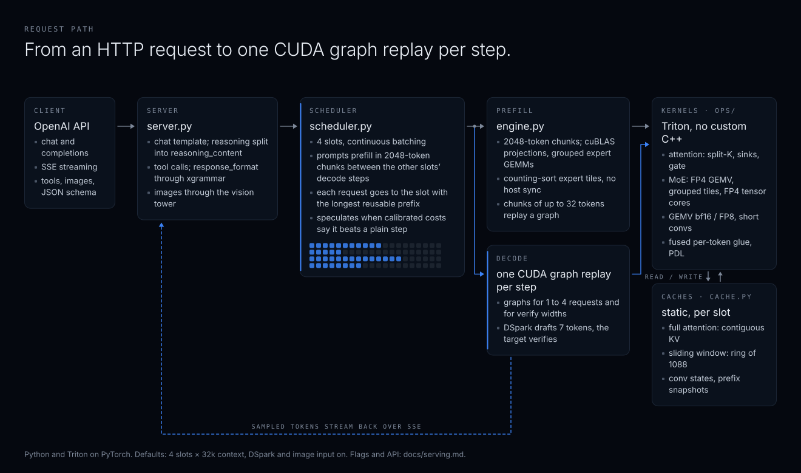
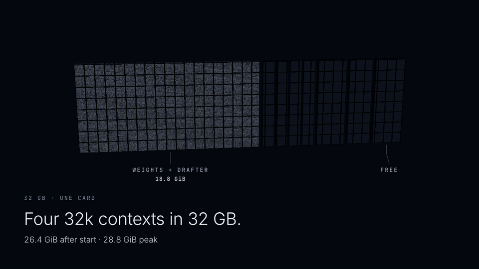

# ⚡ Inkling-2-Mini engine: a 26B looped MoE on one GPU

### 🧠 26B looped MoE · 🔁 48 layer visits per token · 🚀 DSpark speculation · 💾 under 32 GB · 🔌 OpenAI-compatible

[](LICENSE)
[](https://huggingface.co/thinkingmachines/Inkling-2-Mini)
[](docs/benchmarks.md)
[](docs/benchmarks.md)
[](docs/benchmarks.md)
[](docs/benchmarks.md)
[](#-what-was-measured-and-what-was-not)

We're building a single-GPU inference engine for
[Inkling-2-Mini](https://huggingface.co/thinkingmachines/Inkling-2-Mini), the 26B-parameter looped MoE from Thinking
Machines (3.4B active per token), tuned for one RTX PRO 6000 Blackwell and kept within 32 GB. It is Python and Triton on
PyTorch, with an OpenAI-compatible server. Decode uses fused kernels, CUDA graphs and DSpark speculative decoding. The
model math follows SGLang's implementation.

Legend used below: ✅ measured, 🟰 level, ❌ behind or not met, 🧪 not run, 🚧 in progress.

## 🎬 See it run

[](docs/media/inkling-launch-16x9.mp4)

*Launch video (24 s): the looped MoE, the race below, how a step works, and memory. Click to play; [square cut](docs/media/inkling-launch-1x1.mp4).*

<p align="center">
  
</p>

*One GSM8K question on one RTX PRO 6000, no memory cap, every engine on its own flags, played at 1×. Each engine writes its
own answer: 354 tokens for this engine, 349 for vLLM and 513 for SGLang, so compare the times with vLLM; SGLang's answer is
longer. The [rule that picks the question](docs/media/src/race/pick.py) was fixed before the recording, and 1 of 200
questions passed it. In the same recording's warm pass the 24 MT-Bench prompts ran at 288 tok/s (this engine), 190 (SGLang) and 212
(vLLM), in line with the table below.*

## 📈 Latest results (one RTX PRO 6000 Blackwell, Nov 23)

Every engine on the whole card (no memory cap) with its own recommended setup, at most 4 running requests, the same client,
tok/s, medians over two containers. The prompts are 24 MT-Bench questions nothing was tuned on, thinking off, natural
stopping with a 512-token limit (6 to 9 of the 24 answers reach it):

| | 1 request | 1 request, T=1 | 2 requests | 4 requests | random 1k/1k, 1 request | random 1k/1k, 4 requests | TTFT 4k | TTFT 30k |
|---|---:|---:|---:|---:|---:|---:|---:|---:|
| **this engine** (2) | **295** | **284** | 353 | **539** | 300 | **652** | **168 ms** | 1424 ms |
| SGLang (2) | 194 | 189 | 305 | 466 | 192 | 490 | 199 ms | 1585 ms |
| vLLM (2) | 210 | 203 | 327 | 435 | 303 | 404 | 184 ms | 1409 ms |
| vLLM, optimized flags (2) | 212 | 207 | 331 | 441 | 295 | 417 | 193 ms | 1486 ms |

Bold: our lead over the best other engine, where it is larger than the spread between containers.



- ✅ **Ahead:** decode on the MT-Bench prompts for one request (about 1.5x SGLang, 1.4x vLLM) and for four, and time to
  first token at 4k.
- 🟰 **Level:** two requests against vLLM (353 vs 331; its containers reach our slower one) and random 1k/1k with one
  request (300 vs 303).
- ❌ **Behind:** a 30k-token prompt's first token, where vLLM is about 1% faster.
- **Precision differs:** our default uses FP8 dense weights; SGLang and vLLM run theirs in bf16. Fully in bf16
  (`--no-dense-fp8 --no-fp4-prefill`, 32 GB cap, one container of ours and of vLLM), this engine decodes 264 tok/s on the
  MT-Bench prompts against 192 (SGLang) and 211 (vLLM), is level with vLLM at two requests, and takes longer to the first token than
  both, which keep FP4 prefill (230 ms vs 223 and 184 at 4k).
- **Spread:** containers differ by 6-7% for us (12% at two requests) and up to 20% for vLLM, TTFT by about 1%. Read decode
  gaps below 10% as level.
- **Setups:** this engine's server default (FP8 dense weights, FP4 prefill); SGLang's DSpark recipe for this card without
  its multimodal, grammar and tool-parser flags; vLLM 0.34 nightly (`0.34.0rc1.dev1133+g647a76866`, includes #69168) with its
  DSpark recipe, and with the FP8 cache and FLASHINFER attention of its Inkling-2-Mini pull request
  [#69168](https://github.com/vllm-project/vllm/pull/69168). "random 1k/1k" uses that pull request's lengths, but our
  prompts are independent random ids ([why it isn't comparable with that PR](docs/benchmarks.md)).

## 📊 What was measured, and what was not

| Item | Result | Evidence |
|---|---|---|
| ✅ Decode, whole card | the table above | `results/serve_*-uncapped*.json` |
| ✅ Decode, every engine held to 32 GB, MT-Bench | 303 tok/s for one request vs 192 (SGLang), 211 (vLLM) and 212 (vLLM, optimized flags); 552 vs 457, 474 and 446 for four | `results/serve_{ours,sglang,vllm}-heldout*.json`, `serve_vllm-fp8kv{,-2}.json` |
| ✅ Decode, held to 32 GB, the six prompts the scheduler was tuned on | 322 vs 232 (SGLang), 235 (vLLM's default flags) and 260 (its optimized flags); **in-sample for us, not the numbers to quote** | [docs/benchmarks.md](docs/benchmarks.md) |
| 🟰 GSM8K, n = 200 | 0.835-0.840 vs 0.845 (SGLang) and 0.840 (vLLM); raw 5-shot completions without the chat template, standard error about 0.026 | `results/serve_*.json`, [docs/benchmarks.md](docs/benchmarks.md) |
| ✅ Agreement with transformers | KL 1.4e-2 on the prefill logits of one prompt (reference model, bf16; the test's limit is 5e-2) | `tests/gpu/parity.py` |
| ✅ Fused kernels against the reference model | prefill KL 2.4e-3, decode KL 1.4e-2, 11 of 12 greedy tokens equal (300 random tokens, 12 steps) | `bench/bench_fused.py` |
| ✅ State handling (KV, rings, convs, loop passes) | the reference model, one-shot against chunked, bit-exact in fp64 | `tests/gpu/state_exact.py` |
| ✅ Cost of FP8 dense / FP4 prefill | KL 6e-3 / 9e-3 against bf16 (noise floor 3e-3); next-token NLL 0.737 vs 0.732 | `tests/gpu/fp4_e2e.py` |
| ✅ Memory, 4 slots × 32k | 25.9 GiB after start, 27.4 GiB peak; 28.8 GiB by `nvidia-smi` during the benchmark | `tests/gpu/memcheck.py`, `results/` |
| ✅ Long context, 256k in one slot | 24.9 / 27.1 GiB; 131k-token prefill 15.0 s; 118 (plain) / 189 tok/s (DSpark) at 131k | `tests/gpu/longctx.py` |
| ✅ First start, empty kernel cache | 69 s (481 s before the kernel settings were pinned) | [docs/experiments.md](docs/experiments.md) |
| 🧪 RTX 5090 | **never run on one.** It fits: with only 31.0 GiB left free on the PRO 6000 and an empty kernel cache, the default and bf16 setups took four 31k-token prompts at once and the 256k setup a 250k-token prompt, peaking at 28.6 GiB. Its speed is not measured: GeForce cards run bf16 prefill math at half the rate, so the FP8 / FP4 paths matter more | `tests/gpu/fit_5090.py` |
| 🧪 More than 4 concurrent requests, more than one GPU | not measured | |

## 🧩 How it works

<picture>
  <source media="(prefers-color-scheme: light)" srcset="docs/media/decode-step-light.svg">
  
</picture>

Every token makes 48 layer visits (prelude, the loop core three times, coda), and each visit runs 8 of 128 experts.
Each visit is about 12 fused Triton kernels, and a whole decode step replays as one CUDA graph. DSpark drafts 7
tokens ahead and the model verifies them in the same kind of graph.

<p align="center">
  
  
</p>

### 🔀 From request to kernel

<picture>
  <source media="(prefers-color-scheme: light)" srcset="docs/media/request-path-light.svg">
  
</picture>

### 🔩 One layer visit, about 12 launches

<picture>
  <source media="(prefers-color-scheme: light)" srcset="docs/media/kernel-fusion-light.svg">
  
</picture>

More in [docs/architecture.md](docs/architecture.md).

## 💾 Four 32k contexts, or one 256k, under 32 GB

We developed this engine under a 32 GB budget so it fits cards like the RTX 5090.

<p align="center">
  
</p>

<picture>
  <source media="(prefers-color-scheme: light)" srcset="docs/media/memory-layout-light.svg">
  
</picture>

## 🚀 Quick start

```bash
git clone https://github.com/amw720386/inkling-2-mini-inference && cd inkling-2-mini-inference
# Linux, NVIDIA Blackwell (sm_120). Weights: hf download thinkingmachines/Inkling-2-Mini --local-dir /path/to/Inkling-2-Mini
pip install torch==2.9.1 torchvision==0.24.1 --index-url https://download.pytorch.org/whl/cu128
pip install -e ".[server]"
pip install triton==3.6.0   # last: torch pins 3.5.1, and the FP4 prefill needs 3.6
python -m inkling_engine.server --model /path/to/Inkling-2-Mini --port 8000
```

```bash
curl -s localhost:8000/v1/chat/completions -H 'content-type: application/json' \
  -d '{"messages": [{"role": "user", "content": "Hello!"}], "reasoning_effort": "low"}'
```

| | |
|---|---|
| 🔌 API | `/v1/chat/completions`, `/v1/completions`, streaming, tools, images, `response_format`, Prometheus `/metrics` ([serving.md](docs/serving.md)) |
| ⚙️ Defaults | 4 concurrent requests, 32k context, DSpark, FP8 dense weights, FP4 prefill, image input |
| 🎯 bf16 checkpoint math | `--no-dense-fp8 --no-fp4-prefill` |
| 📏 Long context | `--kv-fp8 --max-ctx 262144 --slots 1` |
| ⏱ First start | compiles the Triton kernels, about a minute; the kernel settings ship with the engine |
| 🧰 Requirements | Linux and an NVIDIA Blackwell GPU (sm_120; tested on the RTX PRO 6000) |

## 🔁 Reproduce

Everything runs on [Modal](https://modal.com) (an `RTX-PRO-6000`):

```bash
modal run modal/download_weights.py                        # weights into a Modal volume
modal run modal/engine_app.py::pytest_gpu                  # kernel tests
modal run modal/engine_app.py::parity                      # logits vs transformers
modal run modal/serve_bench.py --engine ours --whole-card  # also: sglang, vllm, vllm-fp8kv; --tag 2 for a second container
python tools/results_table.py --whole-card                 # the results table (--spread: every container)
```

The figures redraw from the same files:

```bash
python tools/plot_comparison.py                            # docs/img/comparison.svg
modal run docs/media/src/race/capture.py --outdir /tmp     # re-record the race; then race/pick.py and race/build_race.py
modal run docs/media/src/render_modal.py                   # every video, GIF and diagram
```

## ⚠️ What is not shown (read before quoting)

- **Two containers is a small sample.** Decode gaps below 10% are level, and the gap at two requests is one of them.
- **The comparison is FP8 dense weights against bf16.** The bf16 comparison is above: 264 vs 192 and 211 tok/s, under the 32 GB cap.
- **Nothing was tuned for the other engines.** They run their own recipes; someone who knows them may do better.
- **The race is one question.** Each engine writes its own answer, so its gap can differ from the table's.
- **Which drafts miss in `dspark.gif`** is illustrative; the accepted tokens are the model's own.
- **Earlier numbers are withdrawn.** Figures published before Nov 23 (363, 325 and 280 tok/s, "545 vs 474") used a client that
  timed only visible text.

### ❌ Tried and dropped

| Idea | Why it went |
|---|---|
| Persistent fused decode MoE in one launch | 104-230 µs against 28.7 µs for separate kernels: too few loads in flight |
| Attention split-combine folded into the attention kernel | 9.7 → 12.3 µs, to remove a 1.4 µs combine |
| Screened LM head (FP8 scores plus an error bound) | the bound certified only 19% of rows |
| NVFP4 copies of the dense weights | simulated KL 1.45e-2, 3x FP8's |
| Router GEMM as three bf16 parts | 1.6x faster, 30x the fp32 error |

The full log, kept and dropped, is in [docs/experiments.md](docs/experiments.md).

## 🗺️ Repo map

| Path | What is there |
|---|---|
| [inkling_engine/](inkling_engine/) | the engine: model, fused kernels (`ops/`), DSpark drafter, scheduler, server |
| [docs/benchmarks.md](docs/benchmarks.md) | every number, how it was measured, quality and numerics, long context |
| [docs/architecture.md](docs/architecture.md) | how the engine works |
| [docs/serving.md](docs/serving.md) | the API, scheduling, flags and profiles |
| [docs/experiments.md](docs/experiments.md) | what changed the numbers, and what was tried and dropped |
| [docs/related-work.md](docs/related-work.md) | other Inkling-2-Mini engines and what this one borrows |
| [docs/media/](docs/media/) | the video, GIFs and diagrams, with their [sources](docs/media/src/) |
| [results/](results/) | the raw result files behind the tables |
| [bench/](bench/), [tests/](tests/), [modal/](modal/), [tools/](tools/) | benchmarks, tests, Modal entry points, table and chart scripts |

## 🚧 Next

- Better draft acceptance at 4 concurrent requests (the expert reads are already close to memory bandwidth)
- Smaller decode-step wins (fused per-visit kernels, verify cost)
- Measurements on an RTX 5090
- Re-run the comparison as SGLang and vLLM update their Inkling support

## 🙏 Credits and license

The model math follows [SGLang](https://github.com/sgl-project/sglang) and transformers' `inkling2_loop`.
[ingine](https://github.com/satellitedown/inkling-2-mini-abliterated-ingine) supplied the DSpark drafter reference
and several design ideas. [vLLM](https://github.com/vllm-project/vllm) supplied the FP4 prefill path. Details are
in [docs/related-work.md](docs/related-work.md).

Apache-2.0, see [LICENSE](LICENSE).
