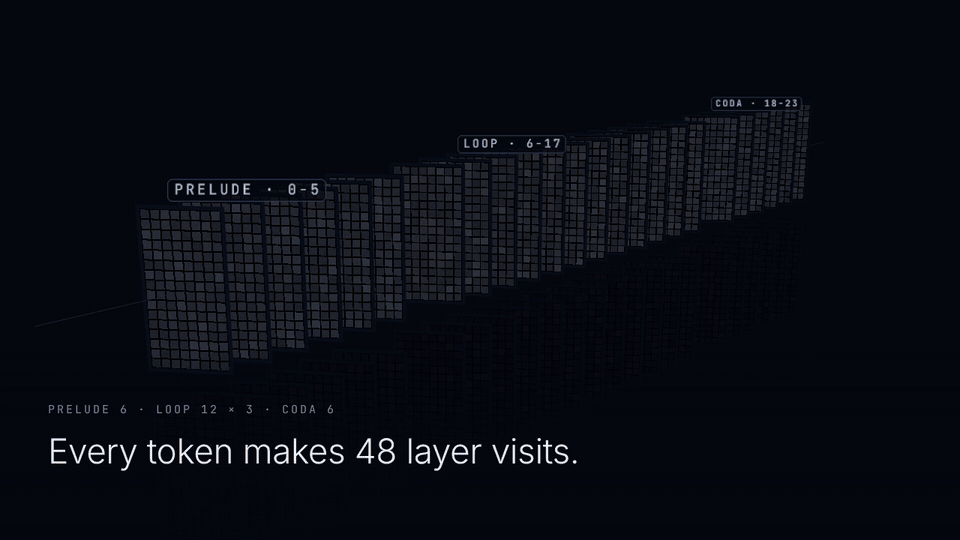

# inkling-2-mini-inference

[](LICENSE)
[](https://huggingface.co/thinkingmachines/Inkling-2-Mini)
[](docs/benchmarks.md)

<p align="center">
  
  <br><sub>Real run on one RTX PRO 6000, played at 1× (<code>--dense-fp8</code> on an earlier version of the engine).</sub>
</p>

We're building a single-GPU inference engine for
[Inkling-2-Mini](https://huggingface.co/thinkingmachines/Inkling-2-Mini), the 26B-parameter looped MoE from Thinking
Machines (3.4B active per token), for one RTX PRO 6000 Blackwell, within 32 GB. It is Python and Triton on PyTorch, with an
OpenAI-compatible server. Decode uses fused kernels, CUDA graphs and DSpark speculative decoding. The model math
follows SGLang's implementation.

## Where it stands

**Ahead** (same GPU, same 32 GB budget, same client, medians over containers):

- **Single-request decode:** greedy 344 vs 235 (vLLM) and 232 (SGLang) tok/s; temperature 1 264 vs 212 and 192.
- **Concurrent requests:** 2 requests 464 vs 302 and 298 tok/s; 4 requests 571 vs 437 and 514.
- **Time to first token:** 167 vs 184 and 223 ms at 4k tokens, and 1420 vs 1675 ms (SGLang) at 30k.
- **More context in 32 GB:** four slots of 32k tokens each, and 256k on one card with an FP8 cache.

  

- **GSM8K** is level with both (0.835-0.840 vs 0.840 and 0.845, n = 200).

**What to know:**

- The server runs FP8 dense weights and FP4 prefill by default, which is not the bf16 checkpoint math.
  `--no-dense-fp8 --no-fp4-prefill` brings it back (decode 273 tok/s greedy, 4k TTFT 230 ms).
- Single-request and 4-request rates depend on the prompts: over the six prompt rotations, individual 4-request
  runs span 513-777 tok/s. Medians are over 2-5 containers per engine.
- The engine should carry over well to an **RTX 5090**: it has the same GB202 chip, the engine fits in 32 GB, and
  decode is limited mainly by memory bandwidth. We haven't measured it on one yet, and GeForce cards run bf16 with
  fp32 accumulation at half rate, so the FP8 / FP4 paths matter more there.


| | decode, greedy | decode, T=1 | TTFT 4k | TTFT 8k | 2 / 4 concurrent | GSM8K |
|---|---:|---:|---:|---:|---:|---:|
| this engine | **344 tok/s** | **264 tok/s** | **167 ms** | **341 ms** | **464 / 571 tok/s** | 0.837 |
| this engine, bf16 | 273 tok/s | 239 tok/s | 230 ms | 467 ms | 437 / 554 tok/s | 0.853 |
| vLLM 0.34 nightly | 235 tok/s | 212 tok/s | 184 ms | does not fit | 302 / 437 tok/s | 0.840 |
| SGLang (Inkling image) | 232 tok/s | 192 tok/s | 223 ms | 434 ms | 298 / 514 tok/s | 0.845 |

All numbers come from an RTX PRO 6000 Blackwell on Modal, with each engine held to a 32 GB budget.

Details:

- [docs/benchmarks.md](docs/benchmarks.md): every number, how it was measured, quality and numerics, long context
- [docs/architecture.md](docs/architecture.md): how the engine works
- [docs/serving.md](docs/serving.md): the API, scheduling, flags and profiles
- [docs/experiments.md](docs/experiments.md): what changed the numbers, and what was tried and dropped
- [docs/related-work.md](docs/related-work.md): other Inkling-2-Mini engines and what this one borrows
- [results/](results/): the raw result files behind the tables

## How it works

<picture>
  <source media="(prefers-color-scheme: light)" srcset="docs/media/decode-step-light.svg">
  
</picture>

Every token makes 48 layer visits (prelude, the loop core three times, coda), and each visit runs 8 of 128 experts.
Each visit is about 12 fused Triton kernels, and a whole decode step replays as one CUDA graph. DSpark drafts 7
tokens ahead and the model verifies them in the same kind of graph.

<p align="center">
  
  
</p>

More in [docs/architecture.md](docs/architecture.md).

## Quick start

```bash
pip install torch==2.9.1 torchvision==0.24.1 --index-url https://download.pytorch.org/whl/cu128
pip install triton==3.6.0                 # newer than torch's pin; needed for --fp4-prefill
pip install -e ".[server]"
python -m inkling_engine.server --model /path/to/Inkling-2-Mini --port 8000
```

```bash
curl -s localhost:8000/v1/chat/completions -H 'content-type: application/json' \
  -d '{"messages": [{"role": "user", "content": "Hello!"}], "reasoning_effort": "low"}'
```

The defaults are 4 concurrent requests, 32k context, DSpark, FP8 dense weights, FP4 prefill and image input. Add
`--no-dense-fp8 --no-fp4-prefill` for the bf16 checkpoint math, or `--kv-fp8 --max-ctx 262144 --slots 1` for long context ([serving.md](docs/serving.md)). The first start compiles
and autotunes the Triton kernels, which takes a few minutes.

## Reproduce

Everything runs on [Modal](https://modal.com) (an `RTX-PRO-6000`):

```bash
modal run modal/download_weights.py                        # weights into a Modal volume
modal run modal/engine_app.py::pytest_gpu                  # kernel tests
modal run modal/engine_app.py::parity                      # logits vs transformers
modal run modal/serve_bench.py --engine ours               # also: ours-bf16, sglang, vllm
python tools/results_table.py && python tools/plot_comparison.py
```

## Next

- Better draft acceptance at 4 concurrent requests (the expert reads are already close to memory bandwidth)
- Smaller decode-step wins (fused per-visit kernels, verify cost)
- Measurements on an RTX 5090
- `--fp4-prefill` without the slight drop in speculative acceptance after an FP4 prefill
- Re-run the comparison as SGLang and vLLM update their Inkling support

## Credits

The model math follows [SGLang](https://github.com/sgl-project/sglang) and transformers' `inkling2_loop`.
[ingine](https://github.com/satellitedown/inkling-2-mini-abliterated-ingine) supplied the DSpark drafter reference
and several design ideas. [vLLM](https://github.com/vllm-project/vllm) supplied the FP4 prefill path. Details are
in [docs/related-work.md](docs/related-work.md).

Apache-2.0, see [LICENSE](LICENSE).
