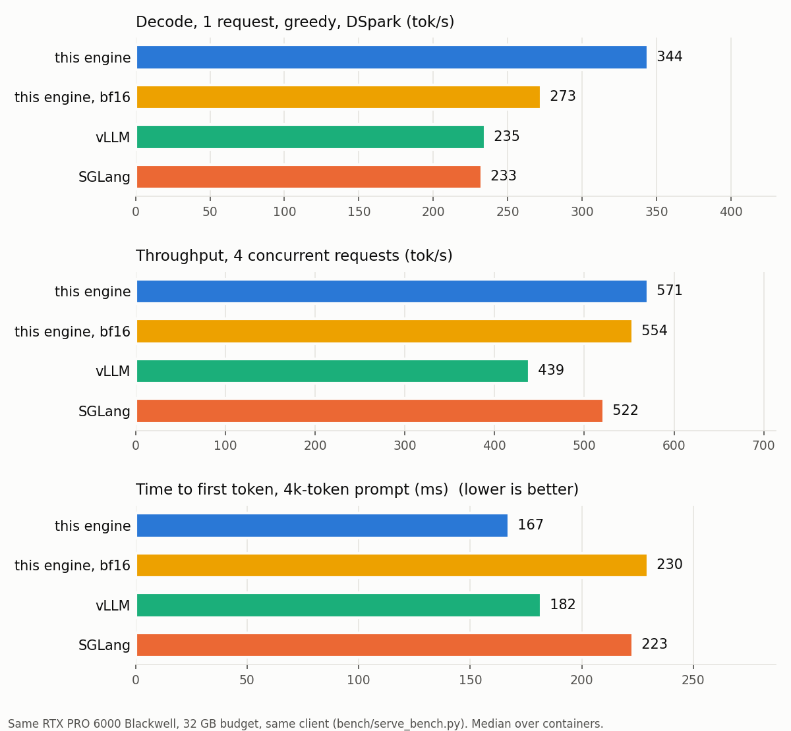

# inkling-2-mini-inference

[](LICENSE)
[](https://huggingface.co/thinkingmachines/Inkling-2-Mini)
[-76b900.svg)](docs/benchmarks.md)

A single-GPU inference engine for [Inkling-2-Mini](https://huggingface.co/thinkingmachines/Inkling-2-Mini), the
26B-parameter looped MoE from Thinking Machines (3.4B active per token), being built for one 32 GB RTX 5090. It is
Python and Triton on PyTorch, with an OpenAI-compatible server. Decode uses fused kernels, CUDA graphs and DSpark
speculative decoding. The model math follows SGLang's implementation.

> **Work in progress.** This is an active project, not a finished result. The numbers below are a snapshot from
> 2026-11-22 on a stand-in GPU (an RTX PRO 6000 with the RTX 5090's chip). It already wins some comparisons and
> clearly loses others. It has not been run on an actual RTX 5090 yet.

## Where it stands

**Ahead so far** (same GPU, same 32 GB budget, same client):

- **Single-request decode** is faster than SGLang and vLLM:
  - greedy: 280 vs 241 / 242 tok/s, or 363 with `--dense-fp8`
  - temperature 1: 262 vs 201 / 206 tok/s
- **More context in 32 GB:** four slots of 32k tokens each, and 256k on one card with an FP8 cache.
- **GSM8K** is within noise of both (0.825-0.835 vs 0.840 / 0.845, n = 200).

**Behind, and being worked on:**

- **4 concurrent requests:** SGLang is about 15% faster (545 vs 454-474 tok/s), and our throughput dips from 2 to
  4 requests. The cause is the scheduler: it leaves the GPU idle about a third of each 4-request step while Python
  bookkeeping runs (`bench/experiments/sched_breakdown.py`). The fix, overlapping that work with the GPU, is in
  progress.
- **Default prefill** is slower than SGLang beyond 4k tokens, because it keeps the checkpoint's bf16 math for the
  expert inputs. `--fp4-prefill` quantizes them to FP4 the way SGLang and vLLM do, and is faster than both.
- **No real RTX 5090 numbers yet.** GeForce cards run bf16 with fp32 accumulation at half rate, so bf16 prefill may
  look worse there.



| | decode, greedy | decode, T=1 | TTFT 4k | TTFT 8k | 4 concurrent | GSM8K |
|---|---:|---:|---:|---:|---:|---:|
| this engine | 280 tok/s | 262 tok/s | 232 ms | 476 ms | 454 tok/s | 0.825 |
| this engine, `--dense-fp8` | **363 tok/s** | **325 tok/s** | 216 ms | 446 ms | 474 tok/s | 0.830 |
| this engine, `--fp4-prefill` | 265 tok/s | 261 tok/s | **183 ms** | **378 ms** | 444 tok/s | 0.835 |
| vLLM 0.34 nightly | 242 tok/s | 206 tok/s | **183 ms** | does not fit | 243 tok/s | 0.840 |
| SGLang (Inkling image) | 241 tok/s | 201 tok/s | 222 ms | 432 ms | **545 tok/s** | 0.845 |

All numbers come from an RTX PRO 6000 Blackwell on Modal, with each engine held to a 32 GB budget. **They are
proxy numbers, not RTX 5090 measurements.**

Details:

- [docs/benchmarks.md](docs/benchmarks.md): every number, how it was measured, quality and numerics, long context
- [docs/architecture.md](docs/architecture.md): how the engine works
- [docs/serving.md](docs/serving.md): the API, scheduling, flags and profiles
- [docs/experiments.md](docs/experiments.md): what changed the numbers, and what was tried and dropped
- [docs/related-work.md](docs/related-work.md): other Inkling-2-Mini engines and what this one borrows
- [results/](results/): the raw result files behind the tables

## Quick start

```bash
pip install torch==2.9.1 torchvision==0.24.1 --index-url https://download.pytorch.org/whl/cu128
pip install triton==3.6.0                 # newer than torch's pin; needed for --fp4-prefill
pip install -e ".[server]"
python -m inkling_engine.server --model /path/to/Inkling-2-Mini --port 8000
```

```bash
curl -s localhost:8000/v1/chat/completions -H 'content-type: application/json' \
  -d '{"messages": [{"role": "user", "content": "Hello!"}], "reasoning_effort": "low"}'
```

The defaults are 4 concurrent requests, 32k context, DSpark and image input. Add `--dense-fp8` for speed, or
`--kv-fp8 --max-ctx 262144 --slots 1` for long context ([serving.md](docs/serving.md)). The first start compiles
and autotunes the Triton kernels, which takes a few minutes.

## Reproduce

Everything runs on [Modal](https://modal.com) (an `RTX-PRO-6000`):

```bash
modal run modal/download_weights.py                        # weights into a Modal volume
modal run modal/engine_app.py::pytest_gpu                  # kernel tests
modal run modal/engine_app.py::parity                      # logits vs transformers
modal run modal/serve_bench.py --engine ours               # also: ours-fp8, sglang, vllm
python tools/results_table.py && python tools/plot_comparison.py
```

## Roadmap

In progress:

- Overlap the scheduler's per-step work with the GPU, to get 4 concurrent requests at least level with SGLang
- Small decode-step wins (fused per-visit kernels, verify cost)

Next:

- Measurements on a real RTX 5090
- `--fp4-prefill` without the slight drop in speculative acceptance after an FP4 prefill
- Re-run the comparison as SGLang and vLLM update their Inkling support

## Credits

The model math follows [SGLang](https://github.com/sgl-project/sglang) and transformers' `inkling2_loop`.
[ingine](https://github.com/satellitedown/inkling-2-mini-abliterated-ingine) supplied the DSpark drafter reference
and several design ideas. [vLLM](https://github.com/vllm-project/vllm) supplied the FP4 prefill path. Details are
in [docs/related-work.md](docs/related-work.md).

Apache-2.0, see [LICENSE](LICENSE).
