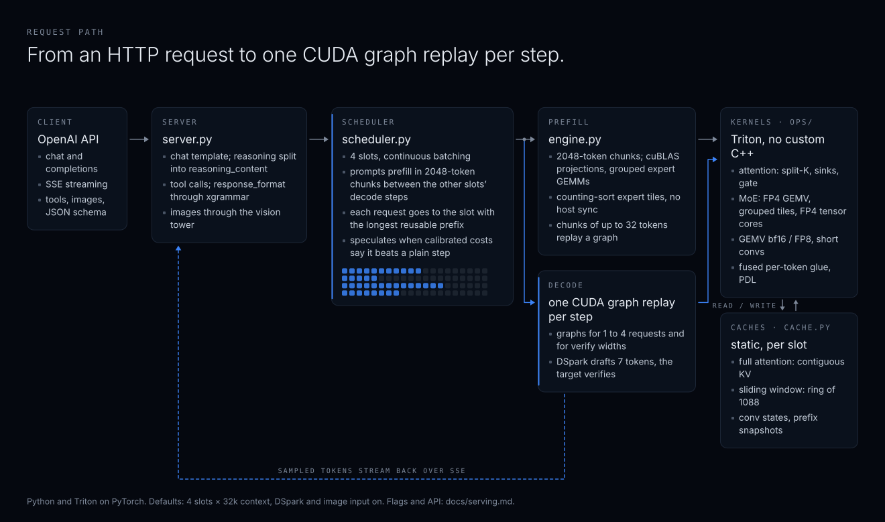
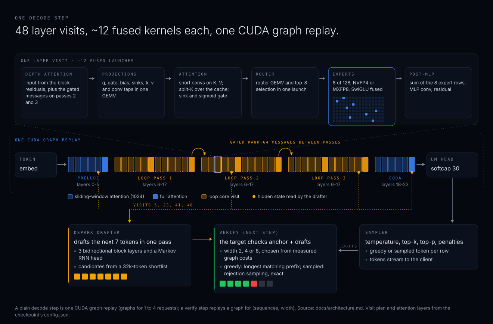
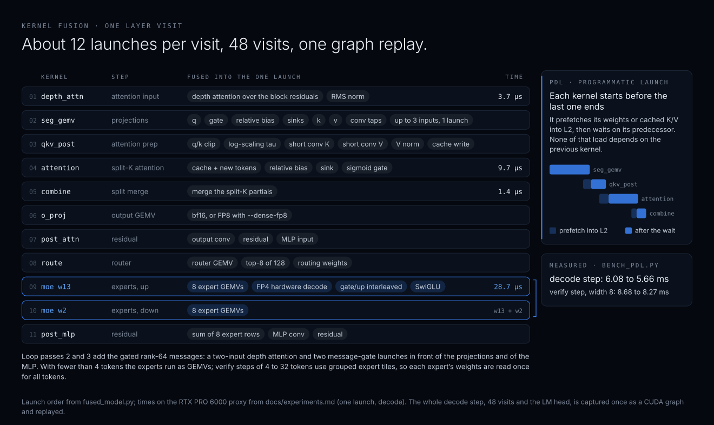
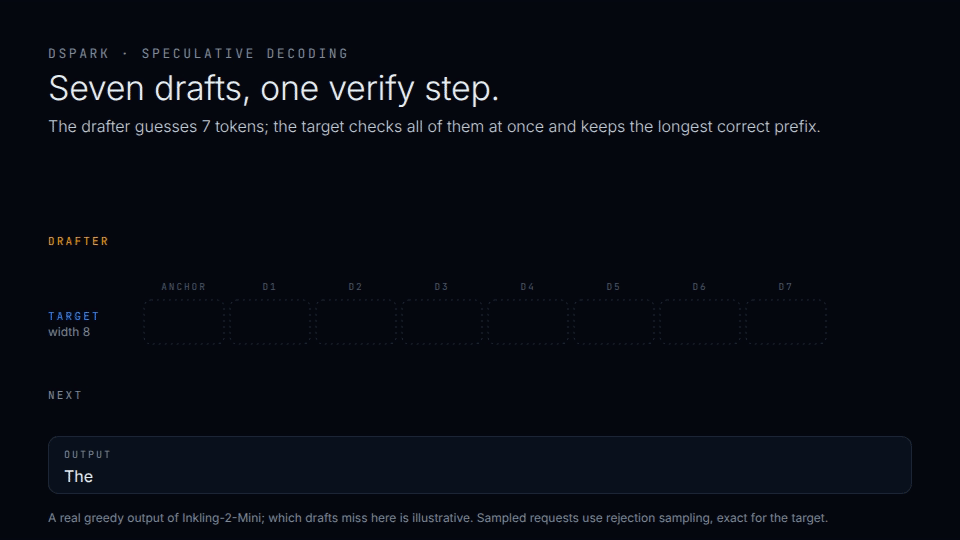
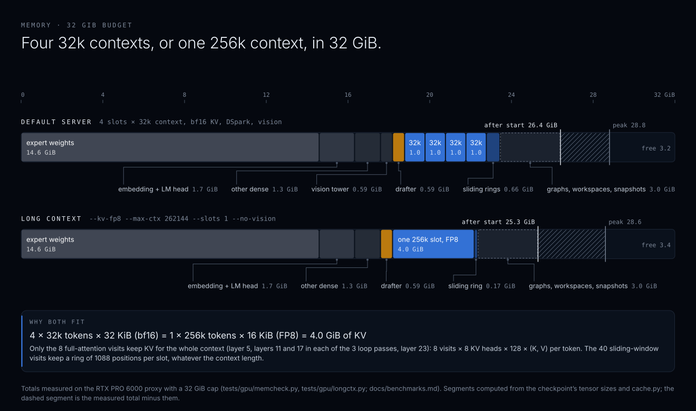

# How the engine works

<picture>
  <source media="(prefers-color-scheme: light)" srcset="media/request-path-light.svg">
  
</picture>

Inkling-2-Mini is a looped MoE: 26.4B parameters in total, 3.4B active per token, hidden size 2304. Its 24 stored
layers form a prelude (0-5), a loop core (6-17) that runs three passes, and a coda (18-23), so every token makes
48 layer visits:

- **Attention:** 20 sliding-window layers (window 1024) and 4 full-attention layers, with 24 query and 8 KV heads.
  Each layer adds a relative-position bias, a per-head attention sink and a sigmoid output gate.
- **Short convolutions:** four per layer, with kernel 4.
- **Residuals:** block attention residuals, and gated rank-64 messages between loop passes.
- **Experts:** 128 routed experts, top-8, stored in NVFP4 (layers 0-19) or MXFP8 (layers 20-23).
- **Drafter:** the checkpoint ships a DSpark drafter (`mtp.safetensors`).

The model math follows SGLang's implementation (sgl-project/sglang#51926) and transformers' `inkling2_loop`. The
engine is Python and Triton on PyTorch, with no custom C++.

## Layout

```
inkling_engine/
  config.py        visit plan (prelude, 3 loop passes, coda) from config.json
  weights.py       checkpoint loading; NVFP4 / MXFP8 experts stay quantized
  quant.py         expert weight containers and reference dequantization
  cache.py         static per-slot KV (contiguous for full attention, ring for sliding windows), conv states
  model.py         reference forward in plain torch ops (exact fp64 mode), used to test everything else
  fused_model.py   the fast forward: ~12 fused launches per layer visit, CUDA-graph decode
  dspark.py        DSpark drafter (port of ingine's reference) with fused glue and a shortlist head
  engine.py        prefill, decode and speculative rounds (single and batched), prefix reuse, graphs
  scheduler.py     continuous batching over the slots, interleaved chunked prefill, cancellation
  sampling.py      temperature / top-k / top-p / penalties, speculative rejection sampling
  grammar.py       response_format through xgrammar
  vision.py        image input (vision tower + processor)
  server.py        OpenAI-compatible HTTP server
  ops/             Triton kernels: attention, MoE (GEMV, grouped, FP4 tensor-core), GEMV (bf16 / FP8), convs,
                   fused per-token glue, drafter glue, PDL helpers
```

## Decode step

<picture>
  <source media="(prefers-color-scheme: light)" srcset="media/decode-step-light.svg">
  
</picture>

<picture>
  <source media="(prefers-color-scheme: light)" srcset="media/kernel-fusion-light.svg">
  
</picture>

Every layer visit for a decode step (1 to 32 tokens) runs about 12 fused kernels:

1. **Depth attention:** forms the attention input from the block residuals and, on loop passes 2 and 3, the gated
   messages.
2. **Projections:** one multi-input GEMV computes q, gate, relative bias, sinks, k, v and the dynamic conv taps
   from up to three different inputs.
3. **Attention prep (`qkv_post`):** clipping, the log-scaling tau, short convs on K and V, K clip and V norm, and
   the cache write.
4. **Attention:** split-K over the cache plus the chunk, with relative bias, sink and gate. The last split
   combines the partial results.
5. **Output projection, then `post_attn`:** output conv, residual and the MLP input.
6. **Routing:** the router and top-8 selection in one launch; the last block selects the experts.
7. **Experts:**
   - Fewer than 4 tokens: an expert GEMV with hardware FP4 decode. The gate/up rows are interleaved, so SwiGLU is
     fused into the first kernel.
   - 4 to 32 tokens (verify steps, batched decode): grouped expert tiles, so each expert's weights are read once
     for all tokens.
8. **`post_mlp`:** sums the expert rows, then the MLP conv and the residual.

A decode step is one CUDA graph replay. There are graphs for batch sizes 1 to `slots`, verify graphs for
(sequences, width), and prefill graphs for chunks of up to 32 tokens.

**Programmatic dependent launch (PDL):** each kernel lets its successor launch right after its own wait. Weight
GEMVs, the router, the message gates and attention all prefetch their weights or cached K/V into L2 before they
wait, because none of that depends on the previous kernel.

## Speculative decoding (DSpark)



- **Drafting:**
  - The drafter has 3 bidirectional block layers and a Markov RNN head.
  - From the target's hidden states at visits 5, 23, 41 and 48, it drafts the next 7 tokens in one pass.
  - Each row's 1024 candidates come from a shortlist of the 32k most frequent tokens.
- **Verifying:**
  - The target checks the anchor plus the drafts at width 2, 4 or 8. The engine picks the width that maximizes
    expected tokens per millisecond from measured graph costs and calibrated draft confidences.
  - Greedy requests accept the longest matching prefix.
  - Sampled requests use speculative rejection sampling, which is exact for the target distribution. The
    drafter samples at 0.8x the request's temperature.
- **Concurrency:** with several requests active, one drafter pass drafts for every slot and one verify graph
  checks them all, with one host sync per round. The engine launches the next round's draft before it hands out
  tokens, so the GPU keeps working during the host's bookkeeping. Rounds use a fixed width per batch size, and the
  scheduler falls back to plain batched steps when every request's recent acceptance is low.

## Prefill

- **Chunks:** prompts prefill in chunks of 2048 tokens. Expert GEMMs are grouped over tiles sorted by expert; a
  counting sort with no host sync assigns the tiles. Projections use cuBLAS.
- **Short chunks:** chunks of up to 32 tokens replay a captured graph.
- **`--fp4-prefill`** (on by default in the server): quantizes the inputs to NVFP4 and runs the expert GEMMs on the
  FP4 tensor cores (as vLLM and SGLang do on this model).
- **`--dense-fp8`** (on by default in the server): runs the projections as FP8 GEMMs.

## Caches and memory

<picture>
  <source media="(prefers-color-scheme: light)" srcset="media/memory-layout-light.svg">
  
</picture>

- **Cache layout:** full-attention layers keep a contiguous per-slot KV cache, in bf16 or E4M3 (`--kv-fp8`).
  Sliding layers keep a ring of window + 64 positions, so rejected draft rows never overwrite live keys.
- **Prefix reuse:** every slot keeps a snapshot of its last prompt (conv states, rings and drafter context). The
  scheduler routes a request to the slot that holds the longest reusable prefix, so a multi-turn chat only
  prefills its new tokens.
- **Memory:** all CUDA graphs share one memory pool. The default server profile fits in 32 GiB with 4.5 GiB to
  spare.

## Testing

- **State handling:** KV, rings, conv states and loop passes are checked bit-exact against the reference model in
  fp64 (`tests/gpu/state_exact.py`).
- **Logits:** compared with transformers' (`tests/gpu/parity.py`).
- **Kernels:** each Triton kernel is checked against eager torch (`tests/gpu/test_*.py`).
- **Server:** an end-to-end API test (`tests/gpu/server_e2e.py`), a mixed-load soak test (`tests/gpu/soak.py`)
  and memory profiles (`tests/gpu/memcheck.py`).
