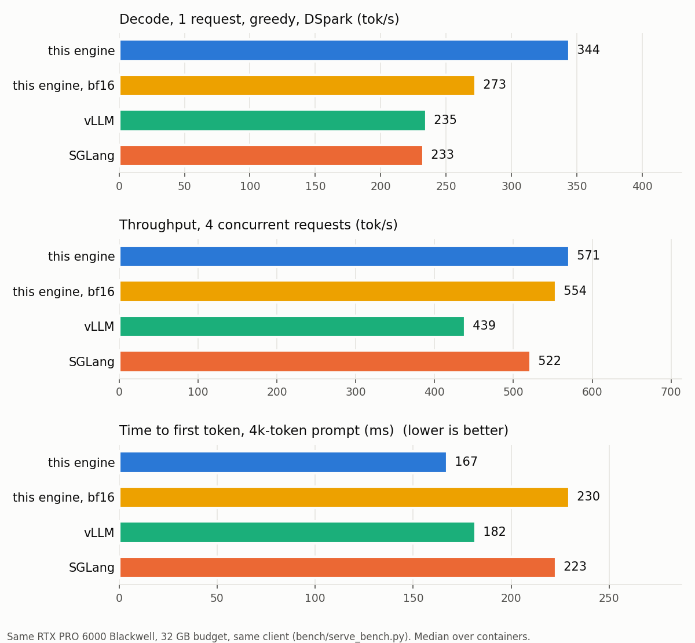

# Benchmarks

**Hardware.** Every number here comes from an NVIDIA RTX PRO 6000 Blackwell on Modal, with the engine held to a
32 GB budget: 188 SMs and about 1.5 TB/s measured memory bandwidth.

**RTX 5090.** The engine should carry over well: a 5090 has the same GB202 / sm_120 chip (170 SMs), similar rated
memory bandwidth, and 32 GB. Decode is memory-bound. GeForce cards run bf16 tensor-core math with fp32 accumulation
at half the PRO card's rate, so bf16 prefill should be slower there and the FP8 / FP4 paths should gain more. None of
this has been measured on a 5090.

## Same GPU, same client: this engine vs vLLM vs SGLang



| | decode, greedy | decode, T=1 | 2 concurrent | 4 concurrent | TTFT 1k | TTFT 4k | TTFT 8k | TTFT 30k | GSM8K | peak GPU |
|---|---:|---:|---:|---:|---:|---:|---:|---:|---:|---:|
| this engine (4) | 344 | 264 | 464 | 571 | 48 ms | 167 ms | 341 ms | 1420 ms | 0.837 | 28.8 GiB |
| this engine, bf16 (2) | 273 | 239 | 437 | 554 | 65 ms | 230 ms | 467 ms | 1884 ms | 0.853 | 28.6 GiB |
| vLLM (2) | 235 | 212 | 302 | 437 | 60 ms | 184 ms | - | - | 0.840 | 32.3 GiB |
| SGLang (5) | 232 | 192 | 298 | 514 | 67 ms | 223 ms | 434 ms | 1675 ms | 0.845 | 31.4 GiB |

The number after each name is how many containers the medians cover. Not every container ran every section.

Each server ran on its own Modal container with the same GPU and a 32 GB budget: our process cap, SGLang's
`--mem-fraction-static 0.232` (chosen here so that `nvidia-smi` stays under 32 GB) and vLLM's
`--gpu-memory-utilization 0.33`. The client
(`bench/serve_bench.py`) sends token-id prompts to `/v1/completions`, so tokenization and chat templates cannot
differ. Measured 2026-11-23: SGLang `lmsysorg/sglang:inkling-2-mini`, vLLM 0.34.0rc1 nightly, this engine with
torch 2.9.1 and Triton 3.6. Raw files: `results/serve_*.json`, one per container; the table is their median
(`tools/results_table.py`, `--spread` for every container).

**Spread between containers** (lowest - highest): decode greedy 322-366 (ours) vs 232-233 (SGLang); T=1 262-267 vs
190-193; 2 requests 458-467 vs 281-312; 4 requests 554-579 vs 500-538. Single-request decode past the natural end of
an answer varies by run.

How to read the columns:

- **decode**: one request at a time, the 6 reference prompts, 256 tokens each with `ignore_eos`, DSpark on for
  every engine. The rate is completion tokens over the whole request (sent to finished), the median of 3 passes.
  Continuing past the natural end of a prompt lowers acceptance for every engine alike, so these are below the
  in-process numbers further down.
- **TTFT**: random-token prompts, a fresh prompt each time, so no prefix cache helps.
- **concurrent**: aggregate output tokens per second for 2 or 4 simultaneous 256-token requests, the median of 6
  prompt rotations after a warm-up.
  Every engine is configured for at most 4 running requests at this memory budget.
- **peak GPU**: the highest `nvidia-smi` reading during the run, including the CUDA context.

Until 2026-11-22 the client divided all tokens by the time between the first and last *visible* text, which left
out special tokens at the end of an answer. Earlier decode numbers for this engine (for example 363 tok/s greedy and
325 at temperature 1 for `--dense-fp8`) were too high and have been withdrawn. The concurrency numbers were best of
two short runs.

**vLLM** could not hold a 32k context in this budget. It reported 7.3 GiB of KV cache left after weights, which is
about 6.9k tokens, so it ran with `--max-model-len 6144`. Its 8k and 30k TTFT are therefore missing, and its
concurrency numbers look starved by the small cache. On a GPU with more memory it would do better.

## In-process numbers

These scripts drive the engine directly, without HTTP, and requests stop at end of sequence. That is why they
differ from the server numbers above. The engine library defaults to bf16; `--dense-fp8` here means `dense_fp8=True`.
Single-request and 8k-prefill rows are from 2026-11-22, before the concurrent-request and prefill changes in
[experiments.md](experiments.md); later same-day runs of the newer engine gave 178 plain and 341 DSpark (bf16).

| Measure | bf16 | `--dense-fp8` | Script |
|---|---:|---:|---|
| decode, 1 request, plain | 172 tok/s | 214 tok/s | `bench/bench_spec.py 256` |
| decode, 1 request, DSpark | 324 tok/s | 353 tok/s | same |
| decode after an 8k prompt, plain / DSpark | 164 / 316 tok/s | 197 / 328 tok/s | same |
| decode at temperature 1, DSpark | 262 tok/s | 262 tok/s | same |
| 2 / 4 concurrent requests, batched DSpark | 406 / 460 tok/s | - | `bench/bench_concurrency.py` |
| 8k prefill, random tokens | 469 ms | 439 ms | `bench/bench_prefill.py 8192 2048 sweep` |
| 8k prefill with `--fp4-prefill` | 373 ms | 343 ms | same |
| 8-token prompt, time to first token | 10.9 ms | - | `bench/bench_ttft.py` |

**Long context** (`--kv-fp8 --max-ctx 262144 --slots 1`, `tests/gpu/longctx.py`):

| Measure | Value |
|---|---:|
| memory after start / peak (with a 30k prefill) | 24.9 / 27.1 GiB |
| prefill of a 131k-token prompt | 15.0 s |
| decode at 131k context, plain / DSpark | 118 / 189 tok/s |

**Memory** (`tests/gpu/memcheck.py`): the default server profile (4 slots × 32k, DSpark, vision) holds 25.9 GiB
after start-up and peaks at 27.4 GiB.

## Quality

GSM8K, 200 test questions, 5-shot, greedy (`tests/gpu/gsm8k_eval.py` in process, `bench/serve_bench.py` through
the server). The standard error at n = 200 is about 0.026, so differences below about 0.05 are noise.

| Configuration | Accuracy |
|---|---:|
| this engine, default (FP8 dense + FP4 prefill, through the server, 2 runs) | 0.835, 0.840 |
| this engine, bf16 (through the server, 2 runs) | 0.850, 0.855 |
| this engine, bf16 (in process, 2026-11-22) | 0.825 - 0.860 |
| SGLang / vLLM (through the server) | 0.845 / 0.840 |

**Agreement with transformers** (`tests/gpu/parity.py`): KL 1.4e-2 on prefill logits, inside the bf16 noise floor
of this model. Two bf16 evaluations of the same tokens with different batch shapes differ by KL ~5e-2.

**State handling** (KV, rings, conv states, loop passes) is bit-exact against the reference model in fp64
(`tests/gpu/state_exact.py`).

**Numerics of the options** (`tests/gpu/fp4_e2e.py`, 3072 tokens of natural text):

| Option | KL vs bf16 | Next-token NLL |
|---|---:|---:|
| bf16 noise floor | 3e-3 | 0.732 (bf16) |
| `--dense-fp8` | 6e-3 | 0.737 |
| `--fp4-prefill` | 9e-3 | 0.737 |

## Reproduce

```bash
modal run modal/download_weights.py                       # weights into a Modal volume
modal run modal/serve_bench.py --engine ours              # also: ours-bf16, sglang, vllm
modal run modal/serve_bench.py --engine ours --tag 2      # another container
python tools/results_table.py                             # the table above, from results/
python tools/plot_comparison.py                           # docs/img/comparison.png
modal run modal/engine_app.py::parity --args "bench_spec.py 256"
```

SGLang runs the `lmsysorg/sglang:inkling-2-mini` image with its DSpark recipe. The cookbook's RTX PRO 6000 and RTX 5090
recipes share these flags; this run adds the 32k context of the RTX 5090 one and the memory cap, and leaves out the
multimodal, grammar and tool-parser flags. vLLM runs the
`vllm/vllm-openai:nightly` image with its Inkling-2-Mini recipe. The exact flags are in `modal/serve_bench.py`.
Raw results are in `results/`; `results/sglang/` holds the earlier SGLang cookbook runs.
